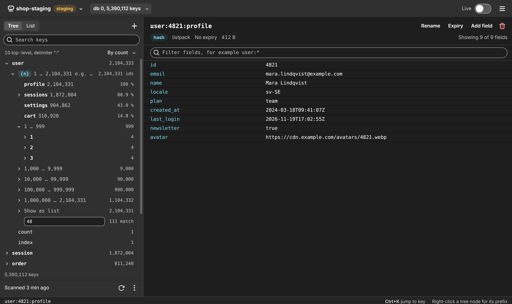
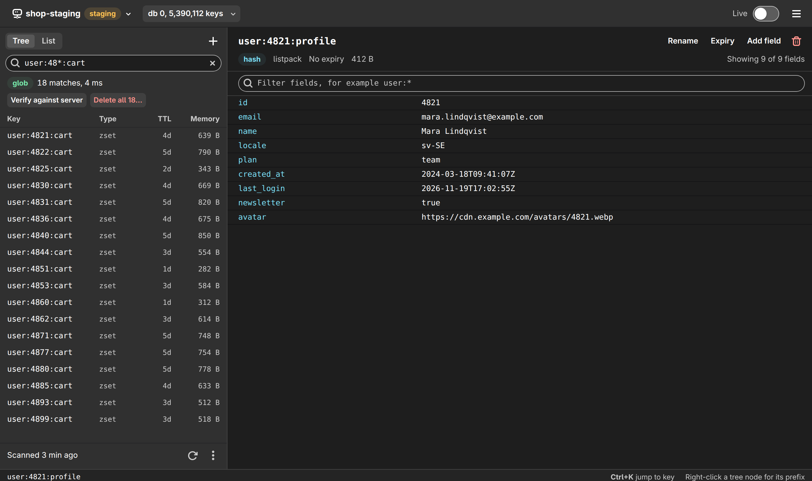
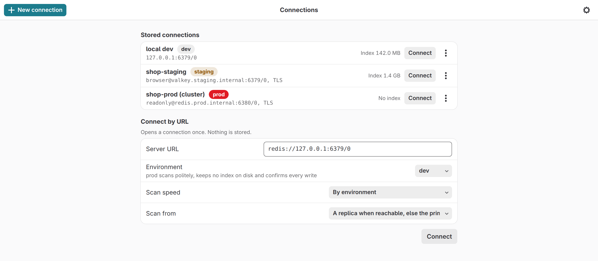
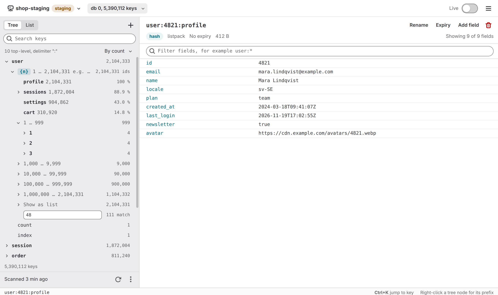

<div align="center">


# Keyfold

**A desktop client for Redis and Valkey that stays fast at ten million keys.**
It indexes the keyspace once, then shows you its structure instead of an endless list of ids.

[](https://github.com/db-mobile/keyfold/actions/workflows/ci.yml)
[](LICENSE)
[](#compatibility)
[](https://tauri.app)

[Why Keyfold?](#why-keyfold) · [Features](#features) · [Screenshots](#screenshots) · [Installation](#installation) · [Command line](#command-line) · [Documentation](#documentation) · [Contributing](#contributing)



</div>

> [!NOTE]
> Keyfold is in early development (0.1.0). Packages exist for Linux only; on macOS and Windows you [build it from source](#build-from-source).

## Why Keyfold?

Most key browsers load pages of `SCAN` results into the window and stop being useful somewhere past a hundred thousand keys. Keyfold is built the other way round.

- **A local index, not a loaded list.** One background `SCAN` builds a SQLite index of the key names on your disk. The tree, the counts, sorting and search all run against that index, so they cost the server nothing and answer in milliseconds.
- **Folding.** When a level consists of generated ids, Keyfold collapses it into a single row such as `user:{n}` and shows what lies beneath those ids, aggregated: `profile` on 100 % of them, `cart` on 14.8 %. Two million ids become four lines you can read.
- **Exact counts everywhere.** Every namespace shows how many keys it holds. During a scan the count is marked as a lower bound (`≥ 14,203`); afterwards it is exact.
- **Careful with your server.** Keyfold never sends `KEYS`. Scans are paced, can read from replicas, back off when the server gets busy, and can be paused and resumed. Connections tagged as production scan politely, keep no index on disk and confirm every write.
- **Redis and Valkey as equals.** Standalone, replicated and cluster deployments of both are tested on every change.

## Features

### Browsing

- **Namespace tree** with a count on every node, sorted by name, count or numeric value. The delimiter is detected from the keys.
- **Folded levels** for numeric ids, UUIDs, ULIDs, hex hashes, dates, timestamps and opaque ids. A fold shows the id range, sample ids, the aggregated structure with coverage, range buckets to click through, a filter box with a live count, and a "show as list" escape hatch. Literal siblings such as `user:count` stay visible next to the fold.
- **Flat key list** that scrolls through the whole keyspace at any position. Type, TTL and memory are fetched only for the rows on screen.
- **Instant reopen.** The index persists per connection and database, so the tree from your last session is there the moment you connect, while a refresh runs in the background.

### Search

- **Glob** (`user:42:*`), **substring** (`session`) and **regex** (`/user:\d+:cart/`) from one search box. The mode is recognised from the syntax and shown as a chip.
- **Exact match counts**, computed from the index.
- **Jump to key** with `Ctrl+K`: type a full key name and open it directly, with your recently opened keys listed first.
- **Verify against server** reconciles a search with the live server through a bounded `SCAN MATCH`, for when the index may be stale.
- **Optional trigram index** for fast substring search on very large keyspaces, built locally without any server traffic.

### Values

- **Viewers for every native type:** strings, hashes, sets, sorted sets, lists and streams. Collections are paged, so a hash with four million fields opens as quickly as one with four.
- **Strings by content:** pretty-printed JSON, text, or a hex dump for binary data. Large values load a preview first and the rest on request.
- **Unknown and module types** fall back to a raw view instead of an error.

### Editing

- **Keys:** create, rename, set or remove the expiry, delete.
- **Contents:** edit strings and JSON, add, change and remove hash fields, set and sorted-set members, list items and stream entries.
- **Pattern delete** with an exact count and a preview of the affected keys before anything happens, then batched `UNLINK` with progress, pause and cancel.
- **Write-through:** every change updates the index in the same action, so the tree never shows a key you just deleted.

### Safety

- **Environment tags** (dev, staging, prod) on every connection, always visible in the header.
- **Production rules enforced in the backend,** not only in dialogs: every write needs a confirmation, and a flush requires typing the connection's name.
- **Passwords in the OS keychain** (Secret Service, macOS Keychain, Windows Credential Manager), never in a config file.
- **A greppable command list.** Every command Keyfold sends on its own is documented in [`docs/commands.md`](docs/commands.md) and checked by a test, so you can write a tight ACL for it.
- **A command console** (`` Ctrl+` ``) for what you type yourself, on a connection of its own. Commands that change connection state, block or stream are not sent; `KEYS`, flushes and other dangerous commands ask first, and the index follows your writes.

### Deployments

- **Cluster support** with routing by slot, `MOVED` and `ASK` handling, and one scan cursor per shard.
- **Replica-first scanning** so the primary stays free for your application.
- **Three scan speeds:** fast, normal (backs off under server load) and polite (replicas only, long gaps).
- **Live mode** (opt-in) keeps the index current from keyspace notifications.
- **Logical databases** are switched from the header, each with its own index.

- **Index modes** per connection: everything, on demand (a sample first, then each subtree as you open it) for databases too large to scan in full, or none (plain `SCAN` pages).
- **SSH tunnels.** A stored connection can go through a bastion host, with the SSH agent, a key file or a password. Cluster nodes and replicas are reached through the same tunnel, and the bastion's host key is shown before it is trusted.

### Look and feel

- A clean GNOME-style interface with light, dark and system themes and nine accent colours.

## Performance

Measured on a generated database of 10,000,000 keys (Redis 8 in Docker, local NVMe):

| What | Result |
| --- | --- |
| First keys on screen after connecting | under a second |
| Full index of 10M keys | 63 to 68 s |
| Index size on disk | 1.4 GB |
| Open any tree level (200 rows, by name) | under 1 ms |
| Glob search `user:42:*` | 5 ms warm, 53 ms cold |
| Full index of 1M keys | 3.5 s |

The scan currently peaks at about 600 MB of backend memory and settles at about 170 MB afterwards. Method, hardware and the remaining gaps are documented in the [architecture notes](docs/ARCHITECTURE.md#benchmark-10m-keys-redis-8-in-docker-local-nvme-22-cores).

## Screenshots

| Search with exact counts | Connections with environment tags |
| :---: | :---: |
|  |  |

| Light theme |
| :---: |
|  |

## Installation

Each [release](https://github.com/db-mobile/keyfold/releases) carries a Debian package and an AppImage for amd64 and arm64. They need Ubuntu 22.04, Debian 12 or a distribution at least as new.

```bash
sudo apt install ./keyfold_<version>_amd64.deb     # Debian, Ubuntu and derivatives
```

```bash
chmod +x keyfold_<version>_amd64.AppImage          # any other distribution
./keyfold_<version>_amd64.AppImage
```

### Build from source

Requires **Node.js** 22+, **Rust** 1.89+ and [Tauri's platform dependencies](https://tauri.app/start/prerequisites/). On Debian or Ubuntu:

```bash
sudo apt install libwebkit2gtk-4.1-dev build-essential curl wget file libssl-dev libayatana-appindicator3-dev librsvg2-dev
```

```bash
git clone https://github.com/db-mobile/keyfold.git
cd keyfold
npm install
npm run tauri dev        # development mode with hot reload
npm run build:tauri      # Debian package and AppImage in target/release/bundle/
```

Packages built on your machine need a system at least as new as yours (they link against your glibc), so they are for your own use, not for distribution.

Need a server to try it against?

```bash
docker run -d --rm --name kv -p 6379:6379 valkey/valkey:9
cargo run --release --bin keyfold -- gen redis://127.0.0.1:6379/0 --keys 1000000 --flush
```

The second command fills the database with a million realistic keys (users, sessions, orders, caches) so there is something to fold.

Development happens on Linux. macOS and Windows builds have not been verified yet.

## Command line

The engine behind the app is also a CLI, useful for scripting and for benchmarking a server before you point a GUI at it:

```bash
keyfold info   redis://127.0.0.1:6379/0                  # server, version, topology
keyfold scan   redis://127.0.0.1:6379/0                  # build the index, with live progress
keyfold tree   <index> "user:" --sort numeric --limit 20 # one level of the tree
keyfold search <index> "user:42:*" --count               # glob, substring or regex
keyfold delete <index> "cache:2024-01-*" --url <url>     # preview; add --yes to delete
keyfold watch  redis://127.0.0.1:6379/0 --seconds 30     # keyspace notifications
```

Build it with `cargo build --release --bin keyfold`.

## Compatibility

| Server | Versions tested in CI | Deployments |
| --- | --- | --- |
| Redis | 7.2, 8.x | standalone, primary with replica, cluster |
| Valkey | 8.x, 9.x | standalone, primary with replica, cluster |

Keyfold detects capabilities by probing the server rather than by version number, so compatible servers and newer versions are expected to work.

## Documentation

- **[Concept](CONCEPT.md)**: the complete design and the reasoning behind each decision
- **[Architecture notes](docs/ARCHITECTURE.md)**: how each part is built, with measurements
- **[Command reference](docs/commands.md)**: every server command Keyfold sends, for ACL authors
- **[UI style guide](docs/UI_STYLE_GUIDE.md)**: the rules the interface follows
- **[Backlog](docs/backlog.md)**: what is open and what is deferred

## Roadmap

- [x] Packaged releases for Linux (Debian package and AppImage, amd64 and arm64)
- [ ] Packaged releases for macOS and Windows
- [ ] Viewers for module types (JSON, time series, probabilistic types, vector sets)
- [ ] Folding for ids with a common prefix or suffix (`sess_a1b2…`, `ORD-2024-00001`)
- [ ] Fold rules and renamed levels saved per connection
- [ ] Folded search results (`user:*:cart` as one row with a count)
- [ ] `MONITOR`, pub/sub and transactions in the console
- [ ] SSH tunnels through `ProxyJump` chains and `~/.ssh/config`
- [ ] Sentinel discovery

## Contributing

Contributions are welcome.

1. Read [`CONCEPT.md`](CONCEPT.md) first; it explains why things are the way they are.
2. Fork the repository and create a feature branch.
3. Run `cargo fmt --all`, `cargo clippy --workspace`, `npm run build` and `npm test` before committing.
4. Run the tests against all four servers with `scripts/matrix.sh` (needs Docker), or against one server with `KEYFOLD_TEST_URL=redis://127.0.0.1:6379/15 cargo test --workspace`. The test database is flushed.
5. Open a pull request.

Found a bug or have an idea? [Open an issue](https://github.com/db-mobile/keyfold/issues).

## License

Keyfold is released under the MIT License; see the [LICENSE](LICENSE) file for details.

Redis is a registered trademark of Redis Ltd. Valkey is a trademark of LF Projects, LLC. Keyfold is an independent project and is not affiliated with or endorsed by either.
